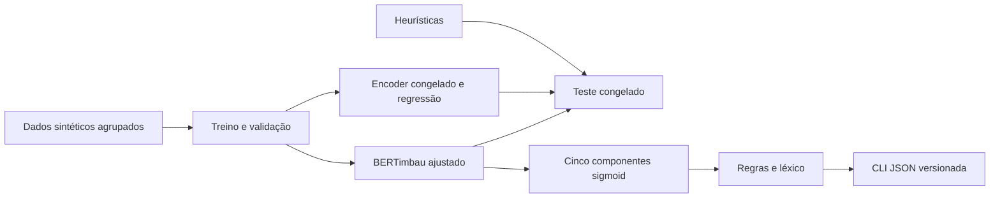

# PatchInsight

Classificação multilabel de componentes em descrições profissionais em pt-BR:
`action`, `context`, `method`, `result` e `measurement`. O projeto separa a
detecção semântica por encoder das regras que reconhecem XYZ, STAR,
Action–Result e Action–Technology. Não atribui notas nem classifica pessoas.

**Estado atual: implementação em verificação, fine-tuning em execução.** Há 400
exemplos congelados, lock resolvido, baselines, CLI tipada, regras e notebook.
Os testes passaram em Python 3.11 (14 aprovados e um aguardando checkpoint real).
O dataset e a Model Card inicial estão publicados no Hugging Face. O benchmark
final e o container aguardam o checkpoint selecionado. [Estado](docs/status.md).

## Arquitetura



Os dados são **gerados, anotados e revisados pela mesma IA**, sem revisão
humana. São 100 cenários com quatro variantes controladas por cenário. Todas
as derivações permanecem no mesmo split: 280 treino, 60 validação, 60 teste.
Há atalhos lexicais deliberadamente documentados; o resultado não estima
desempenho em currículos reais. [Dataset Card](data/README.md) ·
[Guia de anotação](docs/annotation-guide.md) · [Revisão](docs/data-review.md).

## Executar agora sem dependências de ML

Na raiz do projeto, com Python 3.11 ou superior, estes comandos auditam o
material já produzido. A stack completa também foi instalada e testada em Python 3.11.14.

```bash
PYTHONPATH=src python3 -m unittest discover -s tests -p test_core.py -v
PYTHONPATH=src python3 -m patchinsight.data
PYTHONPATH=src python3 -m patchinsight.experiment heuristic --output reports/development
```

O baseline na **validação** obteve macro-F1 0,8530, micro-F1 0,8623 e exact
match 0,5333, sobre 60 referências sintéticas. São medidas de desenvolvimento;
o teste não foi avaliado. Detalhes: [JSON](reports/development/heuristic-validation.json).

## Preparar o ambiente completo

Requer internet e Python 3.11. Dependências diretas estão fixadas no
`pyproject.toml` e as transitivas em `uv.lock`. Instalação a partir do lock:

```bash
python3 -m pip install uv==0.9.7
uv python install 3.11
uv sync --frozen --extra ml --extra dev
uv run --frozen pytest
```

Usar `--frozen` nas reproduções. O núcleo usa PyTorch,
Transformers, scikit-learn e Pydantic. Não requer API paga.

## Treinar e comparar

O [notebook Kaggle/Colab](notebooks/train.ipynb) chama os mesmos módulos Python
da reprodução local. O treino nunca usa os exemplos de teste. A revisão do
[BERTimbau](https://huggingface.co/neuralmind/bert-base-portuguese-cased/commit/94d69c95f98f7d5b2a8700c420230ae10def0baa)
é fixa; configuração em `configs/experiment.json`.

```bash
PATCHINSIGHT_DEVICE=cuda bash scripts/reproduce.sh
```

Esse script audita dados, roda testes, avalia heurísticas na validação, ajusta
regressões sobre embeddings do encoder congelado e faz fine-tuning completo.
Seleciona a época por macro-F1 de validação, com limiares fixos em 0,5. Salva
checkpoint, tokenizer, hashes, histórico e configuração em `artifacts/run-42`.
Em CPU use `PATCHINSIGHT_DEVICE=cpu`; não há promessa de tempo de execução.

Após encerrar as decisões de desenvolvimento, executar uma única avaliação final:

```bash
uv run --frozen python -m patchinsight.evaluate --run artifacts/run-42 --final --device cuda
```

O comando compara os três métodos no mesmo teste e produz métricas por rótulo,
suportes, TP/FP/FN/TN, exact match e previsões em `reports/final`. Recusa
sobrescrever um relatório existente. Não usar erros finais para ajustar a v0.1.
Resultados negativos também devem ser publicados. [Protocolo](docs/experiments.md).

## Inferência e contrato

```bash
uv run --frozen patchinsight predict --model artifacts/run-42/model \
  --text 'Revisei as consultas com SQL e reduzi a espera em 20%.' --json
uv run --frozen patchinsight predict --backend heuristic --text 'OAuth 2.0' --json
```

O primeiro comando exige um checkpoint real. O segundo seleciona explicitamente
o baseline e precisa apenas de Pydantic, instalado por `uv sync --frozen`.
JSON em stdout, erros em stderr, estados presente/ausente/desconhecido,
sigmoids não calibradas, estruturas simultâneas, tecnologias, diagnósticos e
versões. Há sinalização de truncamento. [Contrato completo](docs/contract.md).

## Container e publicação

Depois do treino, copiar o bundle selecionado para `artifacts/model` e executar:

```bash
cp -a artifacts/run-42/model artifacts/model
bash scripts/docker_smoke.sh
```

O Dockerfile incorpora o checkpoint verificado e carrega com modo offline.
O smoke test roda com `--network none`. Build e execução não foram verificados
neste ambiente porque o daemon não está acessível.

O repositório [octopus-synapse/patch-insight](https://github.com/octopus-synapse/patch-insight)
guardará código, dados e documentação. No Hugging Face,
um repositório de modelo guardará os pesos e outro de dataset facilitará o
download dos dados. Destinos: [dataset](https://huggingface.co/datasets/enzoferracini/patchinsight-synthetic-ptbr) e [modelo](https://huggingface.co/enzoferracini/patchinsight-bertimbau-ptbr). [Publicação](docs/publication.md).
O [artigo em pt-BR](docs/article.pt-BR.md) relata o método e o único resultado
real disponível; a comparação final está pendente.

`python3 scripts/package_release.py` cria um pacote público por lista explícita
em `artifacts/`, excluindo PDF, credenciais, ambientes e a especificação de
planejamento original. O repositório local acompanha `main`, com remote SSH configurado.

Código e futuro checkpoint: MIT, preservando aviso NeuralMind. Dados e artigo:
CC BY 4.0. [Proveniência e licenças](licenses/DATA-AND-ARTICLE.md).

Projeto autoral e independente, motivado por candidatura profissional. Não há
integração com Patch Careers, patrocínio, supervisão ou endosso empresarial.
Demo e API REST estão fora da v0.1. Prazo de referência: 16/11/2026.
