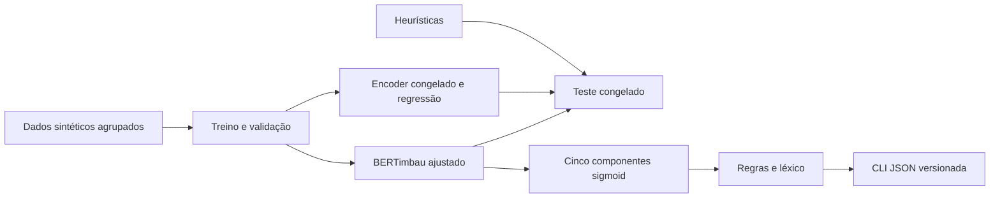

# PatchInsight

**Checkpoint 0.3 refinado e validado localmente.** No teste novo, macro-F1
0,7296 → 1,0000; no diagnóstico conhecido da 0.2, 0,5584 → 0,9752.
O novo teste tem padrões controlados e o diagnóstico já era conhecido; ambos
continuam sintéticos, revisados pela mesma IA. Não há validação humana.
O modelo local padrão foi atualizado; os pesos públicos da release 0.2
continuam 0.1.0. [Resultados, limites e reprodução](docs/v03.md).

**v0.2 publicada: avaliação ampliada, batch, Action–Method e demo.**
Os checkpoints da v0.1 foram avaliados em 36 textos novos, escritos, anotados e
revisados pelo próprio assistente IA, sem revisão humana. Macro-F1: heurísticas
**0,6910**, encoder congelado + regressão **0,6196**, BERT ajustado **0,5584**.
O resultado próximo do teto no teste original não se sustenta neste desafio.
A regressão tem melhor Average Precision; após temperatura experimental, também
menor Brier/log loss entre as variantes avaliadas. Não há validação em currículos reais.

[Resultados e comandos da v0.2](docs/v02.md) · [Novo teste](reports/v02/test/README.md)
· [Análise de erros](reports/v02/error-analysis.md) · [Revisão por IA](docs/v02-data-review.md).
Software/schema/regras: 0.2.0; checkpoint preservado: 0.1.0. A [release v0.2.0](https://github.com/octopus-synapse/patch-insight/releases/tag/v0.2.0)
está publicada no GitHub e ambos os repositórios do Hub têm a tag v0.2.0.
Imagem pública: `ghcr.io/octopus-synapse/patch-insight:v0.2.0`.
[Automação e recuperação de releases](docs/releases.md).

```bash
# Demo local com o checkpoint real; abrir http://127.0.0.1:8765
uv run --frozen --extra ml patchinsight serve --model artifacts/model --device cuda
# Inferência JSONL em lote; usar --backend heuristic para selecionar regras
uv run --frozen --extra ml patchinsight batch --model artifacts/model --input exemplos.jsonl
```

A interface compara modelos por F1, AP, Hamming, MCC, ROC-AUC, Brier e log loss.
Calibração é opt-in; nenhum cutoff cumpriu a meta de abstenção em desenvolvimento,
por isso a política experimental mantém abstenção desativada. Nenhum serviço pago.

As seções abaixo descrevem o experimento original da v0.1, cujos dados e
relatórios finais permanecem intactos. Para reproduzir exatamente o software
daquela release, usar a tag `v0.1.0`; na árvore atual a saída JSON segue o schema 0.2.0.


Classificação multilabel de componentes em descrições profissionais em pt-BR:
`action`, `context`, `method`, `result` e `measurement`. O projeto separa a
detecção semântica por encoder das regras que reconhecem XYZ, STAR,
Action–Result e Action–Technology. Não atribui notas nem classifica pessoas.

**Checkpoint treinado e benchmark final executado.** O fine-tuning completo
selecionou a época 5 por macro-F1 de validação. Quinze testes passaram em
Python 3.11, incluindo carregamento do checkpoint real. [Estado](docs/status.md).

| Método | Macro-F1 | Micro-F1 | Exact match |
|---|---:|---:|---:|
| Heurísticas | 0,6791 | 0,7634 | 0,3333 |
| Encoder congelado + regressão | 0,9888 | 0,9878 | 0,9333 |
| BERTimbau ajustado | 0,9911 | 0,9908 | 0,9500 |

Teste: 60 textos sintéticos de 15 origens, anotados e revisados pela mesma IA.
O ganho de macro-F1 frente à regressão foi 0,0023; bootstrap por origem resultou
em intervalo de 95% de −0,0108 a 0,0145. Não há evidência de superioridade robusta
nem de generalização para currículos reais. [Benchmark](reports/final/README.md)
· [Erros e incerteza](reports/final/error-analysis.md).

## Arquitetura



Os dados são **gerados, anotados e revisados pela mesma IA**, sem revisão
humana. São 100 cenários com quatro variantes controladas por cenário. Todas
as derivações permanecem no mesmo split: 280 treino, 60 validação, 60 teste.
Há atalhos lexicais deliberadamente documentados; o resultado não estima
desempenho em currículos reais. [Dataset Card](data/README.md) ·
[Guia de anotação](docs/annotation-guide.md) · [Revisão](docs/data-review.md).

## Executar agora sem dependências de ML

Na raiz do projeto, com Python 3.11 ou superior, estes comandos auditam o
material já produzido. A stack completa também foi instalada e testada em Python 3.11.14.

```bash
PYTHONPATH=src python3 -m unittest discover -s tests -p test_core.py -v
PYTHONPATH=src python3 -m patchinsight.data
PYTHONPATH=src python3 -m patchinsight.experiment heuristic --output reports/development
```

O baseline na **validação** obteve macro-F1 0,8530, micro-F1 0,8623 e exact
match 0,5333. São medidas de desenvolvimento, distintas do teste final acima.
Detalhes: [JSON](reports/development/heuristic-validation.json).

## Preparar o ambiente completo

Requer internet e Python 3.11. Dependências diretas estão fixadas no
`pyproject.toml` e as transitivas em `uv.lock`. Instalação a partir do lock:

```bash
python3 -m pip install uv==0.9.7
uv python install 3.11
uv sync --frozen --extra ml --extra dev
uv run --frozen pytest
```

Usar `--frozen` nas reproduções. O núcleo usa PyTorch,
Transformers, scikit-learn e Pydantic. Não requer API paga.

## Treinar e comparar

O [notebook Kaggle/Colab](notebooks/train.ipynb) chama os mesmos módulos Python
da reprodução local. A execução publicada utilizou a GPU local NVIDIA RTX
A1000 6 GB, sem custo de nuvem; não se alega sessão no Kaggle/Colab. O treino
nunca usa os exemplos de teste. A revisão do
[BERTimbau](https://huggingface.co/neuralmind/bert-base-portuguese-cased/commit/94d69c95f98f7d5b2a8700c420230ae10def0baa)
é fixa; configuração em `configs/experiment.json`.

```bash
PATCHINSIGHT_DEVICE=cuda bash scripts/reproduce.sh
```

Esse script audita dados, roda testes, avalia heurísticas na validação, ajusta
regressões sobre embeddings do encoder congelado e faz fine-tuning completo.
Seleciona a época por macro-F1 de validação, com limiares fixos em 0,5. Salva
checkpoint, tokenizer, hashes, histórico e configuração em `artifacts/run-42`.
Em CPU use `PATCHINSIGHT_DEVICE=cpu`; não há promessa de tempo de execução.

Após encerrar as decisões de desenvolvimento, executar uma única avaliação final:

```bash
uv run --frozen python -m patchinsight.evaluate --run artifacts/run-42 --final --device cuda
```

O comando compara os três métodos no mesmo teste e produz métricas por rótulo,
suportes, TP/FP/FN/TN, exact match e previsões em `reports/final`. Recusa
sobrescrever um relatório existente. Não usar erros finais para ajustar a v0.1.
Resultados negativos também devem ser publicados. [Protocolo](docs/experiments.md).

## Inferência e contrato

Para usar o checkpoint publicado sem treinar, baixe sua revisão fixa:

```bash
hf download enzoferracini/patchinsight-bertimbau-ptbr \
  --revision f2fb6d8afac7979d754efd947f172c1105a9883c --local-dir artifacts/model
uv run --frozen --extra ml patchinsight predict --model artifacts/model \
  --text 'Revisei as consultas com SQL e reduzi a espera em 20%.' --json
```

Para usar seu próprio treino ou o baseline:

```bash
uv run --frozen patchinsight predict --model artifacts/run-42/model \
  --text 'Revisei as consultas com SQL e reduzi a espera em 20%.' --json
uv run --frozen patchinsight predict --backend heuristic --text 'OAuth 2.0' --json
```

O primeiro comando exige um checkpoint real. O segundo seleciona explicitamente
o baseline e precisa apenas de Pydantic, instalado por `uv sync --frozen`.
JSON em stdout, erros em stderr, estados presente/ausente/desconhecido,
sigmoids não calibradas, estruturas simultâneas, tecnologias, diagnósticos e
versões. Há sinalização de truncamento. [Contrato completo](docs/contract.md).

## Container e publicação

Depois do treino, copiar o bundle selecionado para `artifacts/model` e executar:

```bash
cp -a artifacts/run-42/model artifacts/model
bash scripts/docker_smoke.sh
```

O Dockerfile incorpora o checkpoint verificado e carrega com modo offline.
O smoke test roda com `--network none`, filesystem somente leitura e usuário
sem privilégios. Build e inferência offline foram verificados com o checkpoint
real; [evidência](reports/docker.json). Se já baixou o modelo para
`artifacts/model`, execute diretamente o smoke test, sem copiar outro bundle.

O repositório [octopus-synapse/patch-insight](https://github.com/octopus-synapse/patch-insight)
contém código, dados e documentação. No Hugging Face estão o
[dataset](https://huggingface.co/datasets/enzoferracini/patchinsight-synthetic-ptbr)
e o [modelo ajustado](https://huggingface.co/enzoferracini/patchinsight-bertimbau-ptbr).
Revisões exatas: [publicação](reports/publication.json). O
[artigo em pt-BR](docs/article.pt-BR.md) relata método, comparação final,
incerteza e limites. [Procedimento de publicação](docs/publication.md).

A reprodução em um clone novo e uma nova virtualenv 3.11, com o mesmo lock,
repetiu treino, seleção, teste e carregamento do modelo. Nessa máquina, os pesos
e as métricas coincidiram; isso não garante identidade entre hardwares. Caches
de downloads foram reutilizados. [Relatório](reports/clean-room.json).

`python3 scripts/package_release.py` cria um pacote público por lista explícita
em `artifacts/`, excluindo PDF, credenciais, ambientes e a especificação de
planejamento original. O repositório local acompanha `main`, com remote SSH configurado.

Código e checkpoint: MIT, preservando aviso NeuralMind. Dados e artigo:
CC BY 4.0. [Proveniência e licenças](licenses/DATA-AND-ARTICLE.md).

Projeto autoral e independente, motivado por candidatura profissional. Não há
integração com Patch Careers, patrocínio, supervisão ou endosso empresarial.
Demo e API REST estão fora da v0.1. Prazo de referência: 16/11/2026.
